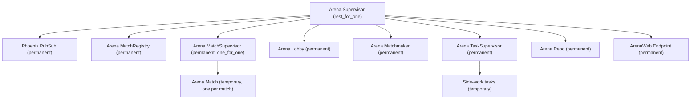

# Arena design

The pure game core and match process are implemented; channel events are planned.

## Rules

Each match runs on a 40 × 30 grid with up to eight snakes. The server advances the simulation at 15 ticks per second. Snakes move one cell per tick, grow and score by eating food, and die on hitting a wall or any snake. The last snake alive wins; if the match reaches three minutes (2,700 ticks), the highest score wins. Simultaneous elimination and equal scores produce a tie. A match starts with at least two players. Food placement uses the match's explicit random seed; occupied cells are never chosen.

## Architecture

`Arena.Game` is a pure, deterministic state-transition core. Its inputs include the current state, player commands, and explicit random seed state; it performs no process operations, clock reads, or implicit random calls. A single `Arena.Match` GenServer per match owns the game state, gathers commands and schedules ticks. Phoenix Channels will validate and translate transport messages, forward commands to the match, and relay server snapshots; they contain no game rules. The server is authoritative: clients never submit positions, scores, or outcomes as truth.

### Core contract

`Arena.Game.new(player_ids, {a, b, c})` requires two to eight unique IDs and creates three-cell, right-facing snakes in the input order, plus one seeded food cell. Coordinates are zero-based, with x increasing right and y increasing down. Bodies are Erlang queues ordered head first. `tick(state, inputs)` accepts a map of player IDs to direction atoms and returns `{state, events}`; absent, invalid, or opposite directions retain the current direction. Unrecognized player IDs are ignored.

All live snakes propose their moves simultaneously. A non-growing snake's tail vacates before collisions; a growing snake's tail remains. A head hitting a wall, any remaining body (including its own), another proposed head, or swapping head positions with another snake dies. Snakes killed on food do not eat or grow. Dead bodies do not block future ticks or food placement. Surviving eaters score one point and grow by one cell; one new food is selected uniformly from free cells using the explicit RNG state. If no cell is free, food remains absent. Events are `{:ate, player_id, cell}`, `{:died, player_id}`, `{:food_spawned, cell}`, and `{:match_over, %{winners: ids, reason: reason}}`, in player ID order followed by food and match events. Initial food is in the returned state, not an event.

If all snakes die on the same tick, the result has no winners and reason `:simultaneous_death`; otherwise a sole survivor wins immediately. On tick 2,700, if multiple snakes remain, the highest score among all participants wins, with all tied players included. Elimination takes precedence over the time limit. A finished game does not advance or emit further events.

### Match lifecycle and API

`Arena.Match.start_match(id, opts)` starts a temporary child under `Arena.MatchSupervisor` registered by nonempty string ID in `Arena.MatchRegistry`. `join(id, player)` admits at most eight unique players; the second starts a three-second countdown, during which others may join. If fewer than two remain, the countdown is cancelled and the match returns to waiting. A waiting match is stopped after 60 seconds without a join or leave. Players cannot join once running. A running player who leaves forfeits: their snake is marked dead immediately and a `:died` event is emitted at the next tick; the normal game rules then determine the result. A finished match is stopped after a ten-second grace period. Matches are temporary children and are not restarted after termination.

`input(id, player, direction)` accepts a valid direction from a joined living player while running, retaining only the latest input until the next tick. `snapshot(id)` returns the current phase, ordered players and game state. A match runs at 15 ticks per second against deadlines derived from a monotonic epoch; if delayed, it catches up without skipping simulation ticks. `manual: true` disables automatic running ticks and allows `tick(id)` to advance exactly one tick. Options `:seed`, `:countdown_ms`, `:idle_ms`, and `:grace_ms` allow deterministic and bounded tests; a seed is generated at match creation if omitted. Countdown, idle and shutdown timers remain active in manual mode.

Subscribers to `Arena.Match.topic(id)` on `Arena.PubSub` receive `{:match_status, id, phase, players}` on membership or phase changes and `{:match_tick, id, game, events}` after each tick, including the final tick. If the match exits abnormally, the lobby publishes `{:match_ended_unexpectedly, id}` on the same topic; normal idle and grace shutdowns are not crashes. `Arena.Lobby.matches/0` lists live match process IDs (including finished matches during their grace period). `Arena.Matchmaker.start_match/2` provides a supervised creation entry point; automatic player matchmaking is not implemented. The published game is the Elixir core state, not a wire-format payload. The future channel must relay unexpected-end notifications as well as serialize state, authenticate and authorize players. Calls for an unknown or already stopped match exit as normal `GenServer.call` failures; callers should handle that boundary.

Supervision tree:

The application uses `:rest_for_one` in the order shown: if PubSub or the registry fails, dependent matches and services restart rather than retain invalid connections or registrations; a match supervisor failure likewise rebuilds its dependents. A lobby failure leaves matches running, and the restarted lobby discovers and monitors surviving registered children before accepting new requests. Matchmaker, task supervisor, Repo and endpoint are permanent services restarted with their dependencies; Repo is late in the order so a database failure does not terminate matches. Individual side-work tasks are temporary and do not restart the task supervisor. Matches are temporary rather than transient because no durable snapshot exists: restarting a crashed process with its original arguments would silently replace an in-progress game with a fresh one. The lobby monitors each match and sends the crash notification before releasing its ID. A match can be recreated after the lobby processes its termination.

Crash notifications are in-memory, best effort, and require a running lobby and PubSub; a lobby or PubSub outage concurrent with a match crash can lose a notification. Lobby recovery restores monitoring of surviving matches, not notifications for matches that disappeared while it was down. No channel transport exists yet, so network clients cannot receive these notifications until that transport is implemented.

## Planned protocol

Phoenix socket topic `match:<match_id>` represents a match. Payloads are JSON objects. Authentication and matchmaking are outside this initial scaffold; production access must authenticate and authorize before joining.

| Direction | Event | Payload / meaning |
| --- | --- | --- |
| Client → server | join topic | Join reply contains player ID, current tick, and full snapshot, or an error such as `full` or `finished`. |
| Client → server | `input` | `{ "direction": "up" \| "down" \| "left" \| "right", "seq": integer }`; the server validates membership, sequence and legal turns. |
| Server → clients | `state` | `{ "tick": integer, "snakes": [...], "food": [...], "scores": {...} }`, an authoritative snapshot. |
| Server → clients | `finished` | `{ "tick": integer, "winners": [player_id], "reason": "last_alive" \| "time_limit" \| "simultaneous_death" }`. |
| Server → client | reply/error | Input acknowledgement or rejection; a client reconnects by rejoining and receiving a full snapshot. |

The match serializes commands and determines their effective tick; clients use tick numbers to discard stale snapshots. Input rate limits remain to be specified when the transport is implemented.
