# Arena design

The pure game core, match process, guest identity, and match channels are implemented.

## Rules

Each match runs on a 40 × 30 grid with up to eight snakes. The server advances the simulation at 15 ticks per second. Snakes move one cell per tick, gain one point and grow by one segment when eating food, and die on hitting a wall or any snake. A purple power-up gives five points without growth; it is collected only by a surviving snake. The last snake alive wins; if the match reaches three minutes (2,700 ticks), the highest score wins. Simultaneous elimination and equal scores produce a tie. A match starts with at least two players. Food and power-up placement use the match's explicit random seed; occupied cells and the other item are never chosen.

## Architecture

`Arena.Game` is a pure, deterministic state-transition core. Its inputs include the current state, player commands, and explicit random seed state; it performs no process operations, clock reads, or implicit random calls. A single `Arena.Match` GenServer per match owns the game state, gathers commands and schedules ticks. Phoenix Channels validate and translate transport messages, forward commands to the match, and relay server snapshots; they contain no game rules. The server is authoritative: clients never submit positions, scores, or outcomes as truth.

### Core contract

`Arena.Game.new(player_ids, {a, b, c})` requires two to eight unique IDs and creates three-cell, right-facing snakes in the input order, plus one seeded food cell. Coordinates are zero-based, with x increasing right and y increasing down. Bodies are Erlang queues ordered head first. `tick(state, inputs)` accepts a map of player IDs to direction atoms and returns `{state, events}`; absent, invalid, or opposite directions retain the current direction. Unrecognized player IDs are ignored.

All live snakes propose their moves simultaneously. A non-growing snake's tail vacates before collisions; a growing snake's tail remains. A head hitting a wall, any remaining body (including its own), another proposed head, or swapping head positions with another snake dies. Snakes killed on an item do not collect it. Dead bodies do not block future ticks or item placement. Surviving food eaters score one point and grow by one cell; surviving power-up collectors score five points without growth. Consumed items are replaced uniformly from free cells using the explicit RNG state; if no cell is free, the item remains absent. Events are `{:ate, player_id, cell}`, `{:power_up_collected, player_id, cell}`, `{:died, player_id}`, `{:food_spawned, cell}`, `{:power_up_spawned, cell}`, and `{:match_over, %{winners: ids, reason: reason}}`, in player ID order followed by item and match events. Initial items are in the returned state, not events.

If all snakes die on the same tick, the result has no winners and reason `:simultaneous_death`; otherwise a sole survivor wins immediately. On tick 2,700, if multiple snakes remain, the highest score among all participants wins, with all tied players included. Elimination takes precedence over the time limit. A finished game does not advance or emit further events.

### Match lifecycle and API

`Arena.Match.start_match(id, opts)` starts a transient child under `Arena.MatchSupervisor` registered by nonempty string ID in `Arena.MatchRegistry`. `join(id, player)` admits at most eight unique players; the second starts a three-second countdown, during which others may join. If fewer than two remain, the countdown is cancelled and the match returns to waiting. A waiting match is stopped after 60 seconds without a join or leave. Players cannot join once running. An explicit `leave` forfeits a running snake immediately, with a `:died` event on the next tick. A finished match is stopped after a ten-second grace period. Normal shutdowns are not restarted; abnormal match exits restart from the checkpoint.

`input(id, player, direction)` accepts a valid direction from a joined living player while running, retaining only the latest input until the next tick. `snapshot(id)` returns the current phase, ordered players and game state. A match runs at 15 ticks per second against deadlines derived from a monotonic epoch; if delayed, it catches up without skipping simulation ticks. `manual: true` disables automatic running ticks and allows `tick(id)` to advance exactly one tick. Options `:seed`, `:countdown_ms`, `:idle_ms`, and `:grace_ms` allow deterministic and bounded tests; a seed is generated at match creation if omitted. Countdown, idle and shutdown timers remain active in manual mode.

Match-process state is versioned; `Arena.MatchState` performs explicit sequential migrations and `Arena.Match.code_change/3` applies them. Recovery also migrates old checkpoints before resuming. See [UPGRADES.md](UPGRADES.md) for the unverified remote-console demonstration and its operational limits.

Subscribers to `Arena.Match.topic(id)` on `Arena.PubSub` receive `{:match_status, id, phase, players}` on membership or phase changes and a `Phoenix.Socket.Broadcast` for each tick (`state` or `delta`). The lobby publishes `{:match_recovering, id}` and `{:match_recovered, id, pid}` around an abnormal match restart; if recovery does not complete within fifteen seconds it publishes `{:match_ended_unexpectedly, id}`. `Arena.Lobby.matches/0` lists live match process IDs (including finished matches during their grace period). Calls for an unknown or restarting match can fail; callers should handle that boundary.

### Crash recovery and disconnects

`Arena.MatchStore` owns a private ETS table independent of individual match processes. Matches synchronously save their game, RNG, buffered inputs, membership, connection PIDs, lifecycle, and deadlines before acknowledging relevant changes and before broadcasting each tick. When peers are connected, a checkpoint must be acknowledged by at least one other node's `Arena.MatchReplica` before it is committed locally; if all connected replicas are unavailable the checkpoint fails rather than acknowledging an unreplicated update. A single isolated node continues without a replica. The restart selects the highest available checkpoint sequence for the same unique match instance, re-arms lifecycle and disconnect timers, re-monitors surviving sessions, publishes a full snapshot and status, and resumes from that checkpoint. Match creation first replicates an instance-specific marker, so a missing recovery checkpoint is not silently treated as a new match. A crash between checkpoint and broadcast is repaired by the recovery snapshot. A running match resets its scheduling epoch after recovery, so time spent restarting pauses simulation rather than producing a catch-up burst; simulation ticks and the three-minute tick limit do not advance during that pause. Normal match shutdown deletes its checkpoint; supervisor shutdown retains it for handoff.

The channel atomically attaches its process to the signed player ID. When the last session for a player dies, the match clears buffered input and starts a ten-second monotonic reconnect deadline; the snake continues in its current direction. A matching guest reconnecting before the deadline reclaims the same snake and cancels the timer. After expiry the player is removed and forfeits on the next tick; if the snake dies naturally before reconnecting it cannot be reclaimed. Multiple simultaneous sessions for one guest do not start the deadline until the last one disconnects. Deadlines survive a match-process restart. If a session dies while the match process itself is down, its deadline begins when the restarted match observes the dead process, not at the unknowable instant of disconnect.

Each backup is volatile ETS on another node, not durable storage. A single-node deployment, simultaneous loss of owner and its sole replica, or a failure before a newly joined peer receives its first synchronization can lose a match. Replicas are refreshed on node joins and periodically, and stale entries expire after 30 minutes. Horde and its registry are eventually consistent, not a consensus/fencing system: network partitions can run competing owners and do not provide exactly-once simulation. Cross-node deadline translation uses wall-clock offsets and assumes synchronized clocks. Recovery notifications are best effort; a concurrent lobby/PubSub outage can prevent notification. The supervisor permits up to 1,000 transient restarts in five seconds; a persistent failure can exhaust that limit and take down dependent services.

`mix test test/arena/match_recovery_test.exs --max-cases 2` includes 50 consecutive seeded chaos games with randomized kill positions. `mix run --no-start bench/checkpoint.exs` measures 100,000 synchronous ETS-owner writes against an empty-loop baseline using an eight-snake checkpoint. The chaos test and checkpoint cost could not be run in the current environment because Erlang/Elixir and Hex access are unavailable; no pass count or timing is claimed.

### Matchmaking and lobby

`Arena.Matchmaker.quick_play(player)` queues the calling process and monitors it; player IDs must be unique within the queue. The FIFO queue forms a match as soon as eight players are waiting, or when ten seconds have elapsed since the first queued player and at least two are available. A lone player stays queued after the deadline, and a subsequent second player starts a match immediately. If the queue becomes empty, its deadline is discarded. `cancel(player)` removes only the calling process's entry; a disconnected queued process is removed automatically. Players receive `{:match_found, match_id, player}` when selected. The selected IDs are supplied atomically when the match is created, then the usual three-second match countdown runs. Queued monitors are released after selection; handling disconnects after assignment is the transport's responsibility. If creating a match fails, queued players receive `{:matchmaking_error, player, reason}` and remain queued; the system-clock matchmaker retries after one second.

For deterministic tests, start a separate matchmaker with `name: nil, clock: :manual` and call `advance(pid, milliseconds)`; production uses monotonic time and process timers. Queue state is in-memory and is lost if the matchmaker restarts.

`create_private(player)` creates a room with its creator already joined and returns an eight-character random hexadecimal code. `join_private(code, player)` accepts the code case-insensitively and uses the normal match capacity and countdown rules. Codes are short invitations, **not authentication**; a future transport must authenticate and authorize players and rate-limit code guesses. Private rooms are omitted from public lobby snapshots. `Arena.Lobby.open_matches/0` returns public waiting/countdown matches with vacancies as `%{id: id, player_count: count, capacity: 8}`; on creation, membership/phase changes and termination the lobby broadcasts `{:lobby_updated, rooms}` on `Arena.Lobby.topic()` (`"lobby"`). Subscribers should fetch an initial snapshot separately; updates are in-memory and eventually consistent with match processes.

Authenticated socket clients may also join `lobby:queue` and push `quick_play` or `cancel`; the channel process owns its queue entry and receives `match_found` with the assigned match ID or `queue_error` on creation failure. The separate load-test bots use this same channel and match transport.

Supervision tree:

```mermaid
graph TD
  App["Arena.Supervisor (rest_for_one)"]
  App --> PromEx["Arena.PromEx (permanent)"]
  App --> PubSub["Phoenix.PubSub (permanent)"]
  App --> Discovery["libcluster discovery"]
  App --> Registry["Horde MatchRegistry"]
  App --> Replica["Arena.MatchReplica (ETS)"]
  App --> Store["Arena.MatchStore (permanent, ETS owner)"]
  App --> Matches["Horde MatchSupervisor (distributed)"]
  Matches --> Match["Arena.Match (transient, one per match)"]
  App --> Observability["Arena.Observability (permanent)"]
  App --> Lobby["Arena.Lobby (permanent)"]
  App --> Matchmaker["Arena.Matchmaker (permanent)"]
  App --> Tasks["Arena.TaskSupervisor (permanent)"]
  Tasks --> Task["Side-work tasks (temporary)"]
  App --> Writer["Arena.ResultWriter (permanent)"]
  App --> Repo["Arena.Repo (permanent)"]
  App --> Endpoint["ArenaWeb.Endpoint (permanent)"]
```



The application uses `:rest_for_one` in the order shown: if PubSub or the registry fails, dependent matches and services restart rather than retain invalid connections or registrations; a match supervisor failure likewise rebuilds its dependents. A lobby failure leaves matches running, and the restarted lobby discovers and monitors surviving distributed children. Horde registry and dynamic supervisor membership follows connected nodes automatically. Lobby lifecycle announcements travel through Phoenix PubSub, and `Horde.Registry` resolves a match from any converged node. Matches are transient so abnormal exits restore a checkpoint, while normal stops do not restart. `MatchReplica` and `MatchStore` precede the distributed supervisor so they outlive an individual match.

### Cluster setup and verification

Distributed local nodes use libcluster Gossip on loopback multicast, UDP port 22350, with `ARENA_CLUSTER_STRATEGY=gossip` (the default for a named node). Set the same project-local distribution cookie and optionally `ARENA_GOSSIP_SECRET` on all nodes. Configure EPMD on loopback port 22351 and the Erlang distribution listener range 22352–22359; each node needs a unique name such as `arena1@127.0.0.1`. Unnamed local development runs without discovery. Test configuration disables discovery and connects test peers explicitly.

The failover test is `mix test test/arena/cluster_test.exs --max-cases 2`. It requires the calling VM to already be distributed on loopback, `ERL_EPMD_PORT=22351`, and an EPMD instance bound to `127.0.0.1` on that port. Start the test VM with a project-local cookie and kernel options `inet_dist_use_interface {127,0,0,1}`, `inet_dist_listen_min 22352`, `inet_dist_listen_max 22359`, and at most one scheduler per test node. The test uses OTP `:peer` standard I/O for startup and `LocalCluster.stop_member/1` for lifecycle cleanup. This is a necessary deviation from invoking `LocalCluster.start/0`: local_cluster 2.1.0 starts OTP's boot server, which hardcodes UDP port 4368 and an ephemeral TCP listener on all interfaces, outside this repository's required port/interface boundaries. The test fails with a prerequisite message rather than silently skipping when distribution is not enabled. Stop only the project-scoped EPMD instance you started, after confirming no other nodes use it.

For a project-scoped test VM after provisioning that loopback EPMD, an example is:

```sh
ERL_EPMD_ADDRESS=127.0.0.1 ERL_EPMD_PORT=22351 ELIXIR_ERL_OPTIONS="+S 1:1 -name arena_test@127.0.0.1 -setcookie arena_test_local -kernel inet_dist_use_interface {127,0,0,1} inet_dist_listen_min 22352 inet_dist_listen_max 22359" mix test test/arena/cluster_test.exs --max-cases 2
```

`docker-compose.cluster.yml` adds three release nodes to the existing Compose PostgreSQL service, using libcluster DNS polling of the shared `arena-node` alias. Set `SECRET_KEY_BASE` and `ARENA_CLUSTER_COOKIE` in the environment and build with `docker compose -f docker-compose.yml -f docker-compose.cluster.yml up --build`; run database migrations once before accepting games. The container HTTP listener binds its private container interfaces for Docker routing, while host-published ports 22300, 22302 and 22303 bind only to loopback; Erlang EPMD and distribution ports stay inside the 22300–22399 range. This Compose configuration is supplied for an environment where Docker is explicitly authorized; it has not been run here and must not use the sandbox's host Docker socket. Its exact base image pins Elixir 1.17.3 and OTP 27.3.4.12, but dependency resolution is not locked because Hex is unavailable.

The three-node failover and replica tests, Horde/libcluster dependency resolution, Gossip/DNS discovery, and Docker configuration remain **unverified** here: Erlang/Elixir are absent and shell DNS cannot resolve Hex. The exact requested `local_cluster`-managed startup is also not verified because its fixed boot-server ports violate the project boundary; the test uses the compatible loopback `:peer` approach described above instead. No split-brain, failover latency, or network-partition guarantees are claimed without running those tests.

### Production release probes

`GET /healthz` is liveness only. `GET /readyz` checks `SELECT 1` and requires the configured number of connected nodes to appear in both Horde membership views, including the current node. `ARENA_CLUSTER_EXPECTED_NODES` defaults to one and the two-node Compose configuration sets it to two. Thus a single survivor deliberately returns 503 until its peer rejoins, even though it may still run recovered matches. nginx uses passive upstream failure handling rather than readiness-aware routing. The multi-stage `Dockerfile`, `docker-compose.prod.yml`, migration command and targeted manual-tick failover script are described in [README.md](README.md); their Docker and live-cluster behavior is unverified in this sandbox.

## Results and leaderboard

PostgreSQL stores `players` (guest ID, display name and insertion time), `match_results` (public match ID, unique random result ID, simulation duration in milliseconds, winner IDs, reason and final scores), and `player_stats` (wins, best score and matches played). A distinct result ID is generated when a match is created, so reusing a private-room code or public match ID does not collapse two matches. Tied winners each receive a win; a result with no winners increments no win counters. All participants, including eliminated or forfeiting players, count as having played. A player is inserted on their first recorded result, using the signed display name seen on channel attachment, or a `Guest-` fallback when they never attached; a later verified name replaces a fallback.

At match end the match process atomically puts its final checkpoint and result into the ETS owner's in-memory outbox, then wakes `Arena.ResultWriter` without performing database operations. The writer starts at most two supervised tasks and retries errors with exponential backoff (one to thirty seconds). Result insertion and stat updates are one database transaction, with a unique result ID preventing duplicate wins or matches on retries or process recovery. Successful and duplicate commits publish `{:leaderboard_updated, match_id}` on `"leaderboard"`; `/leaderboard` subscribes and displays the top 20 by wins and by best score, with deterministic tie ordering. A database outage cannot block the tick loop, though the local ETS outbox can grow while writes fail. A pending result included in a still-live finished match's checkpoint can be requeued on failover; the outbox itself is node-local and is not durable across VM or `MatchStore` failure, so queued results can still be lost after a match exits. It is not a replacement for a durable production job queue.

`mix test test/arena/results_test.exs --max-cases 2` exercises idempotence, ties, rankings, live updates, and slow/failing PostgreSQL transactions using the Ecto SQL sandbox. It requires the configured local PostgreSQL service. The current sandbox environment has neither the pinned Elixir/OTP toolchain nor accessible Hex/PostgreSQL, so these database tests and the tick-latency assertions are not verified here.

## Observability

Phoenix LiveDashboard is mounted at `/dashboard`, with the custom Arena page at `/dashboard/arena`; PromEx exports Prometheus text at `/metrics`. The added dependencies are `phoenix_live_dashboard ~> 0.8.7` and `prom_ex ~> 1.11.0`. The custom page shows node-local active population, tick/overrun counts and last duration, inbound/outbound message counts, and quick-play wait count and total; its in-memory counters reset on observability-process restart. PromEx separately exports histograms, counters and gauges from the same events. Metrics deliberately have no match/player labels to avoid unbounded cardinality and disclosing identifiers. The dashboard, metrics plug and `/loadtest/measurements` accept loopback `remote_ip` only; the application itself binds to loopback. A reverse proxy connecting from loopback must independently authenticate and restrict these paths, since forwarded headers are not treated as proof of client identity.

| Telemetry event | Measurements | Metadata / meaning |
| --- | --- | --- |
| `[:arena, :match, :tick]` | `duration_ns`, `duration_us`, `tick` | `match_id`; monotonic duration covers simulation, checkpoint, result enqueue and update broadcast. |
| `[:arena, :match, :overrun]` | `count: 1`, `duration_ns` | `match_id`; emitted and warning logged for each tick strictly longer than 1/15 second. |
| `[:arena, :population]` | `matches`, `players` | `match_id` of the triggering update, or nil on initialization; counts running matches and their living snakes, including players within disconnect grace. Waiting/countdown/finished matches are excluded. |
| `[:arena, :channel, :message]` | `count` | `direction`, `event`, `match_id`, `player_id`; counts application-level joins, replies, inputs and server pushes. Tick broadcasts use the match's current attached-session count as estimated fanout because Phoenix fastlane bypasses per-channel callbacks; races during join/disconnect can overcount or undercount. Transport heartbeats and protocol frames are excluded. |
| `[:arena, :matchmaking, :wait]` | `wait_ms` | `match_id`, `player_id`; emitted for each successfully grouped quick-play player, using the matchmaker's monotonic or test clock. |

Match, channel and result-write processes attach `match_id` and, where applicable, `player_id` to Logger metadata. Match/player IDs are present in telemetry metadata and logs but not Prometheus labels. `mix test test/arena/telemetry_test.exs --max-cases 2` covers event measurements, overruns, fanout, queue waits, the scrape endpoint and dashboard access. These Elixir tests and actual Prometheus/LiveDashboard startup have not been verified in the current environment because Elixir/OTP and Hex package access are unavailable.

Crash notifications are in-memory, best effort, and require a running lobby and PubSub; a lobby or PubSub outage concurrent with a match crash can lose a notification. Lobby recovery restores monitoring of surviving matches, not notifications for matches that disappeared while it was down.

## Guest identity and channel protocol

`GET /guest` issues a random guest ID and display name signed with `Phoenix.Token`, with a 30-day maximum age and `Cache-Control: no-store`. Supplying an existing token in `Authorization: Bearer <token>` returns the same identity if valid, otherwise a new identity. The `/play` example stores the token in browser local storage and connects to `/socket/websocket` using it as the `token` parameter. The socket verifies the token on connect and the channel verifies it again on join. A token is a bearer credential: use HTTPS/WSS in production, protect against XSS, and redact socket query strings from access logs. There is no revocation, account recovery, or authenticated account linkage.

Phoenix socket topic `match:<match_id>` represents a match. A valid guest may join a public match with room, or join a private match by knowing its full `room-<code>` ID. Previously assigned players may reconnect within their grace period, while new players cannot join after it starts; finished matches reject joins. Guest identity and the room code are not a substitute for full authorization or rate limiting.

| Direction | Event | Payload / meaning |
| --- | --- | --- |
| Client → server | join topic | Reply includes `player` (ID and name), `phase`, and `state` (null before start), or a reason such as `full`, `finished`, `started`, `not_found`, or `invalid_token`. |
| Client → server | `input` | `{ "direction": "up" \| "down" \| "left" \| "right" }`; a reply acknowledges or rejects it. The match buffers the latest accepted direction; the core validates turns. |
| Client → server | `ping` | Empty payload; the reply is used to measure round-trip latency. |
| Client → server | `resync` | Empty payload; reply contains the current full `state`, or an error if the match is unavailable. |
| Server → client | `status` | `{ "phase": string, "players": [player_id], "countdown_ms": integer \| null }` after joining and on membership or phase changes. |
| Server → client | `state` | `{ "state": { "tick": integer, "width": integer, "height": integer, "snakes": {...}, "food": [x,y] \| null, "power_up": [x,y] \| null, "result": object \| null }, "events": [...] }` on the first tick, every 30 ticks (two simulation seconds), and after joining a running match. Snakes contain head-first body cells, direction, alive flag and score. |
| Server → client | `delta` | `{ "tick": integer, "moves": {player_id: {"head": [x,y], "tail_moved": boolean, "direction": string}}, "deaths": [player_id], "scores": {player_id: new_score}, "events": [...] }`. Item changes include `food_removed`/`food_added` or `power_up_removed`/`power_up_added` (each a cell or null); `result` is included when it changes. Stationary forfeited snakes appear in `deaths` without a move. |
| Server → client | `match_ended` | `{ "reason": "unexpected" \| "unavailable" }` when a match cannot recover or cannot be reached. Normal results appear in `state.result` and the `match_over` event. |
| Server → client | `match_recovering`, `match_recovered` | Empty payloads marking a process restart. Recovery is followed by a full snapshot/resync. |
| Server → client | `player_disconnected`, `player_reconnected` | `{ "player": player_id }` when the last session disconnects or a player reclaims their snake. |

The match serializes commands and determines their effective tick. Clients apply only the next consecutive delta, discard older ticks, and request `resync` after a gap or missing baseline; the periodic full snapshot is another recovery point. A full snapshot at the current tick is reapplied so it can correct state changed between ticks. Because the wire protocol has no separate snapshot revision, it cannot distinguish a stale equal-tick snapshot from a newer one; this remains a correctness gap in [ROADMAP.md](ROADMAP.md). A match compares against the last *published* game, so a forfeit between ticks is included. `Arena.GameUpdates` uses Phoenix's channel fastlane dispatcher: the broadcast is encoded once per serializer per local PubSub dispatch and reused for all matching socket transports, rather than encoded once per player. Mixed serializers or distributed nodes each require their own encoding. Input sequence numbers and rate limits are not implemented.

Tick-generated `state` and `delta` broadcasts also include `server_tick_at_ms`, the server wall-clock time at tick start, for same-host load testing. Join and recovery snapshots may omit it. Clients must not use this wall clock for simulation or authority.

### Message size measurement

Measured with `node --test --test-concurrency=2 test/js/bandwidth.test.mjs`: a synthetic quiet tick with eight 22-character IDs, ten cells per snake, no item changes and a `match:benchmark` topic encoded as Phoenix v2 JSON frames is **1,373 bytes full** versus **731 bytes delta** (UTF-8 JSON only, excluding WebSocket framing, compression, TLS and the tick timestamp). For 30 identical-sized ticks, the previous full-every-tick scheme is **41,190 bytes**, versus **22,572 bytes** for 29 deltas and one full snapshot, a **45.2%** reduction. This is a reproducible fixture calculation, not a measured running-server workload: body lengths, deaths, events, topic length and snapshot timing change real savings, and short snakes may yield larger deltas. The Elixir serializer and live network behavior remain unverified in the current environment.

## Browser client

`/lobby` is a LiveView with quick play, room creation and code joining, and a PubSub-driven list of public open matches. A signed guest token is obtained before LiveView connects and is verified in its connected mount. The LiveView process owns its queue entry, so disconnecting while queued removes it. Selecting a match navigates to `/matches/<id>`; private match pages show the room code for sharing.

The `Game` LiveView hook opens the authenticated match channel, sends arrow/WASD directions, displays the countdown, scores, result, and a two-second ping round-trip measurement. Its `requestAnimationFrame` loop interpolates snake segments from the previous authoritative snapshot to the latest over one 15 Hz tick interval (typically drawing at 60 Hz); missing ticks trigger resynchronization and snap to the recovered state rather than extrapolating. Rendering does not change server state. Hook teardown closes the channel, socket, timer and animation loop. JavaScript is kept under `assets/js/game/`; Phoenix/LiveView ES modules are served from installed dependencies, while the game modules are embedded at compile time for releases.
