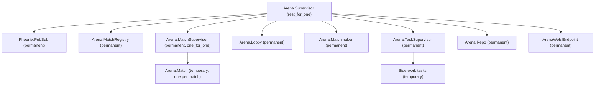

# Arena design

The pure game core, match process, guest identity, and match channels are implemented.

## Rules

Each match runs on a 40 × 30 grid with up to eight snakes. The server advances the simulation at 15 ticks per second. Snakes move one cell per tick, grow and score by eating food, and die on hitting a wall or any snake. The last snake alive wins; if the match reaches three minutes (2,700 ticks), the highest score wins. Simultaneous elimination and equal scores produce a tie. A match starts with at least two players. Food placement uses the match's explicit random seed; occupied cells are never chosen.

## Architecture

`Arena.Game` is a pure, deterministic state-transition core. Its inputs include the current state, player commands, and explicit random seed state; it performs no process operations, clock reads, or implicit random calls. A single `Arena.Match` GenServer per match owns the game state, gathers commands and schedules ticks. Phoenix Channels validate and translate transport messages, forward commands to the match, and relay server snapshots; they contain no game rules. The server is authoritative: clients never submit positions, scores, or outcomes as truth.

### Core contract

`Arena.Game.new(player_ids, {a, b, c})` requires two to eight unique IDs and creates three-cell, right-facing snakes in the input order, plus one seeded food cell. Coordinates are zero-based, with x increasing right and y increasing down. Bodies are Erlang queues ordered head first. `tick(state, inputs)` accepts a map of player IDs to direction atoms and returns `{state, events}`; absent, invalid, or opposite directions retain the current direction. Unrecognized player IDs are ignored.

All live snakes propose their moves simultaneously. A non-growing snake's tail vacates before collisions; a growing snake's tail remains. A head hitting a wall, any remaining body (including its own), another proposed head, or swapping head positions with another snake dies. Snakes killed on food do not eat or grow. Dead bodies do not block future ticks or food placement. Surviving eaters score one point and grow by one cell; one new food is selected uniformly from free cells using the explicit RNG state. If no cell is free, food remains absent. Events are `{:ate, player_id, cell}`, `{:died, player_id}`, `{:food_spawned, cell}`, and `{:match_over, %{winners: ids, reason: reason}}`, in player ID order followed by food and match events. Initial food is in the returned state, not an event.

If all snakes die on the same tick, the result has no winners and reason `:simultaneous_death`; otherwise a sole survivor wins immediately. On tick 2,700, if multiple snakes remain, the highest score among all participants wins, with all tied players included. Elimination takes precedence over the time limit. A finished game does not advance or emit further events.

### Match lifecycle and API

`Arena.Match.start_match(id, opts)` starts a temporary child under `Arena.MatchSupervisor` registered by nonempty string ID in `Arena.MatchRegistry`. `join(id, player)` admits at most eight unique players; the second starts a three-second countdown, during which others may join. If fewer than two remain, the countdown is cancelled and the match returns to waiting. A waiting match is stopped after 60 seconds without a join or leave. Players cannot join once running. A running player who leaves forfeits: their snake is marked dead immediately and a `:died` event is emitted at the next tick; the normal game rules then determine the result. A finished match is stopped after a ten-second grace period. Matches are temporary children and are not restarted after termination.

`input(id, player, direction)` accepts a valid direction from a joined living player while running, retaining only the latest input until the next tick. `snapshot(id)` returns the current phase, ordered players and game state. A match runs at 15 ticks per second against deadlines derived from a monotonic epoch; if delayed, it catches up without skipping simulation ticks. `manual: true` disables automatic running ticks and allows `tick(id)` to advance exactly one tick. Options `:seed`, `:countdown_ms`, `:idle_ms`, and `:grace_ms` allow deterministic and bounded tests; a seed is generated at match creation if omitted. Countdown, idle and shutdown timers remain active in manual mode.

Subscribers to `Arena.Match.topic(id)` on `Arena.PubSub` receive `{:match_status, id, phase, players}` on membership or phase changes and `{:match_tick, id, game, events}` after each tick, including the final tick. If the match exits abnormally, the lobby publishes `{:match_ended_unexpectedly, id}` on the same topic; normal idle and grace shutdowns are not crashes. `Arena.Lobby.matches/0` lists live match process IDs (including finished matches during their grace period). The published game is the Elixir core state, not a wire-format payload; the channel serializes it and relays crash notifications. Calls for an unknown or already stopped match exit as normal `GenServer.call` failures; callers should handle that boundary.

### Matchmaking and lobby

`Arena.Matchmaker.quick_play(player)` queues the calling process and monitors it; player IDs must be unique within the queue. The FIFO queue forms a match as soon as eight players are waiting, or when ten seconds have elapsed since the first queued player and at least two are available. A lone player stays queued after the deadline, and a subsequent second player starts a match immediately. If the queue becomes empty, its deadline is discarded. `cancel(player)` removes only the calling process's entry; a disconnected queued process is removed automatically. Players receive `{:match_found, match_id, player}` when selected. The selected IDs are supplied atomically when the match is created, then the usual three-second match countdown runs. Queued monitors are released after selection; handling disconnects after assignment is the transport's responsibility. If creating a match fails, queued players receive `{:matchmaking_error, player, reason}` and remain queued; the system-clock matchmaker retries after one second.

For deterministic tests, start a separate matchmaker with `name: nil, clock: :manual` and call `advance(pid, milliseconds)`; production uses monotonic time and process timers. Queue state is in-memory and is lost if the matchmaker restarts.

`create_private(player)` creates a room with its creator already joined and returns an eight-character random hexadecimal code. `join_private(code, player)` accepts the code case-insensitively and uses the normal match capacity and countdown rules. Codes are short invitations, **not authentication**; a future transport must authenticate and authorize players and rate-limit code guesses. Private rooms are omitted from public lobby snapshots. `Arena.Lobby.open_matches/0` returns public waiting/countdown matches with vacancies as `%{id: id, player_count: count, capacity: 8}`; on creation, membership/phase changes and termination the lobby broadcasts `{:lobby_updated, rooms}` on `Arena.Lobby.topic()` (`"lobby"`). Subscribers should fetch an initial snapshot separately; updates are in-memory and eventually consistent with match processes.

Supervision tree:

The application uses `:rest_for_one` in the order shown: if PubSub or the registry fails, dependent matches and services restart rather than retain invalid connections or registrations; a match supervisor failure likewise rebuilds its dependents. A lobby failure leaves matches running, and the restarted lobby discovers and monitors surviving registered children before accepting new requests. Matchmaker, task supervisor, Repo and endpoint are permanent services restarted with their dependencies; Repo is late in the order so a database failure does not terminate matches. Individual side-work tasks are temporary and do not restart the task supervisor. Matches are temporary rather than transient because no durable snapshot exists: restarting a crashed process with its original arguments would silently replace an in-progress game with a fresh one. The lobby monitors each match and sends the crash notification before releasing its ID. A match can be recreated after the lobby processes its termination.

Crash notifications are in-memory, best effort, and require a running lobby and PubSub; a lobby or PubSub outage concurrent with a match crash can lose a notification. Lobby recovery restores monitoring of surviving matches, not notifications for matches that disappeared while it was down.

## Guest identity and channel protocol

`GET /guest` issues a random guest ID and display name signed with `Phoenix.Token`, with a 30-day maximum age and `Cache-Control: no-store`. Supplying an existing token in `Authorization: Bearer <token>` returns the same identity if valid, otherwise a new identity. The `/play` example stores the token in browser local storage and connects to `/socket/websocket` using it as the `token` parameter. The socket verifies the token on connect and the channel verifies it again on join. A token is a bearer credential: use HTTPS/WSS in production, protect against XSS, and redact socket query strings from access logs. There is no revocation, account recovery, or authenticated account linkage.

Phoenix socket topic `match:<match_id>` represents a match. A valid guest may join a public match with room, or join a private match by knowing its full `room-<code>` ID. Previously assigned players may reconnect to a running match, while new players cannot join after it starts; finished matches reject joins. Guest identity and the room code are not a substitute for full authorization or rate limiting. Channel disconnect currently retains membership; it does not automatically forfeit, so another connection using the same token may rejoin without cancelling an active player. A future transport policy must handle abandoned players and duplicate sessions.

| Direction | Event | Payload / meaning |
| --- | --- | --- |
| Client → server | join topic | Reply includes `player` (ID and name), `phase`, and `state` (null before start), or a reason such as `full`, `finished`, `started`, `not_found`, or `invalid_token`. |
| Client → server | `input` | `{ "direction": "up" \| "down" \| "left" \| "right" }`; a reply acknowledges or rejects it. The match buffers the latest accepted direction; the core validates turns. |
| Client → server | `ping` | Empty payload; the reply is used to measure round-trip latency. |
| Server → client | `status` | `{ "phase": string, "players": [player_id], "countdown_ms": integer \| null }` after joining and on membership or phase changes. |
| Server → client | `state` | `{ "state": { "tick": integer, "width": integer, "height": integer, "snakes": {...}, "food": [x,y] \| null, "result": object \| null }, "events": [...] }` on each tick, and an initial snapshot after joining a running match. Snakes contain head-first body cells, direction, alive flag and score. |
| Server → client | `match_ended` | `{ "reason": "unexpected" \| "unavailable" }` when the match crashes or cannot be reached. Normal results appear in `state.result` and the `match_over` event. |

The match serializes commands and determines their effective tick; clients discard stale snapshots. Input sequence numbers and rate limits are not implemented.

## Browser client

`/lobby` is a LiveView with quick play, room creation and code joining, and a PubSub-driven list of public open matches. A signed guest token is obtained before LiveView connects and is verified in its connected mount. The LiveView process owns its queue entry, so disconnecting while queued removes it. Selecting a match navigates to `/matches/<id>`; private match pages show the room code for sharing.

The `Game` LiveView hook opens the authenticated match channel, sends arrow/WASD directions, displays the countdown, scores, result, and a two-second ping round-trip measurement. Its `requestAnimationFrame` loop interpolates snake segments from the previous authoritative snapshot to the latest over one 15 Hz tick interval (typically drawing at 60 Hz); missing ticks snap to the latest snapshot rather than extrapolating. Rendering does not change server state. Hook teardown closes the channel, socket, timer and animation loop. JavaScript is kept under `assets/js/game/`; Phoenix/LiveView ES modules are served from installed dependencies, while the game modules are embedded at compile time for releases.
