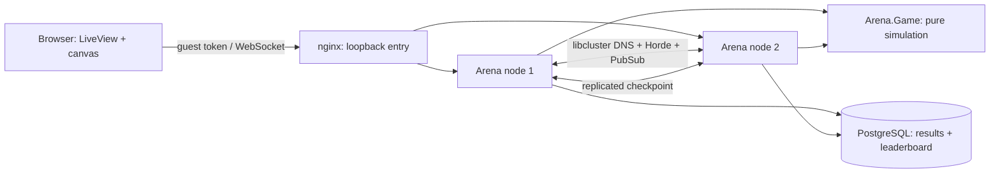
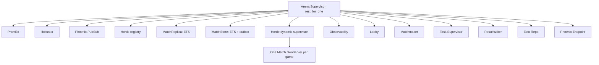

# Arena

Arena is a server-authoritative, real-time multiplayer snake game for two to eight guests. Matches use a 40 × 30 grid at 15 ticks per second. Food adds one point and one segment; purple power-ups add five points without growth. Hitting a wall or another snake is fatal. The last snake alive wins, or the highest score wins after three minutes. Ties are possible.

## Architecture





The core simulation has no processes, clock calls, or implicit randomness. Channels are transport only; per-match processes schedule authoritative ticks, checkpoint state and publish deltas. See [DESIGN.md](DESIGN.md) for rules, protocol, supervision, recovery and observability details.

## Local development

Install the versions in `.tool-versions` and dependencies **inside this repository**, then run `mix local.hex`, `mix deps.get --locked`, `mix ecto.setup`, and `mix phx.server`. PostgreSQL is configured at `127.0.0.1:22301`; `docker-compose.yml` describes a project-local database for environments where Docker is explicitly authorized. This sandbox must not use the host Docker socket. The app listens on `http://127.0.0.1:22300`; open `/lobby`, use quick play or a private room, and play with arrow keys or WASD. `/leaderboard` shows completed-match statistics.

For a disposable native PostgreSQL test instance in a restrictive sandbox, keep `postgres` in a foreground process owned by the test runner rather than daemonizing it with `pg_ctl start`; stop that owned process before removing its project-local socket, data and log files. A detached server may be outside a later shell's permitted signal scope. If the standard stop command is denied, do not route signals through another process or a database command: leave the live files intact and report the PID, port and paths to an authorized controller. Verify the listener itself is gone rather than relying solely on `pg_ctl status`, which can also be affected by signal restrictions.

`/healthz` is process liveness and does not query dependencies. `/readyz` returns 200 only when PostgreSQL responds and both Horde membership views contain at least `ARENA_CLUSTER_EXPECTED_NODES` connected nodes, including the current node; otherwise it returns 503 with boolean checks. Readiness is not proof of replica durability or partition safety.

## Production release and Compose cluster

Build locally with `MIX_ENV=prod mix deps.get --locked` and `MIX_ENV=prod mix release`, then use `_build/prod/rel/arena/bin/arena`. Runtime requires `DATABASE_URL` and `SECRET_KEY_BASE`; `PHX_SERVER=1` enables HTTP. `PORT` defaults to 22300, `POOL_SIZE` to 10, and `ARENA_CLUSTER_EXPECTED_NODES` to 1. For distributed releases, configure a project-local `RELEASE_COOKIE`, `RELEASE_NODE`, `RELEASE_DISTRIBUTION`, loopback EPMD/distribution ports, and the libcluster strategy as described in [DESIGN.md](DESIGN.md). Run migrations with `bin/arena eval 'Arena.Release.migrate()'`. Do not commit secrets or generated release files.

`Dockerfile` is a multi-stage production release build. `docker-compose.prod.yml` defines PostgreSQL, a one-shot migration, two DNS-clustered app nodes and an nginx WebSocket proxy. Container HTTP listeners bind their private container interfaces; host ports 22300 and 22301 are published on loopback only. PostgreSQL data is retained at `./.data/postgres-prod`; never point the example at an existing database you do not intend to use. In an environment **outside this sandbox** where Docker is explicitly authorized, set `ARENA_DB_PASSWORD`, `ARENA_DATABASE_URL` (for example `ecto://postgres:<URL-encoded-password>@postgres:5432/arena_prod`), `SECRET_KEY_BASE` and `ARENA_CLUSTER_COOKIE` in the environment, then run:

```sh
docker compose -p arena-prod -f docker-compose.prod.yml up --build -d
```

Visit `http://127.0.0.1:22300/lobby`. With this disposable stack, `scripts/compose_failover.sh --confirm` creates a manual-tick demo match, verifies its replica, kills **only app1**, checks that app2 resumes the identical tick-3 game and advances it, and probes nginx liveness. It then attempts to stop its own match and restore app1. Set `ARENA_COMPOSE_PROJECT` if using a different Compose project name. It prints any cleanup failure; it does not remove database data. The script verifies process/state recovery, not a live player's WebSocket reconnection. Afterward use `docker compose -p arena-prod -f docker-compose.prod.yml down` to stop the stack; do not delete pre-existing data. No Docker daemon was operated in this sandbox.

## Testing and measurements

- `mix check` runs warnings-as-errors compilation, ExUnit, formatting, strict Credo and Dialyzer. The three-node cluster test requires a named loopback VM and project-scoped EPMD/distribution ports; see [DESIGN.md](DESIGN.md). It fails with a prerequisite message rather than silently skipping without distribution.
- ExUnit includes StreamData properties for deterministic simulation and delta reconstruction, Ecto sandbox persistence tests, channel/LiveView tests, and 50 seeded crash/recovery games. These require the pinned toolchain, dependencies and a local test database.
- `node --test --test-concurrency=2 test/js/*.test.*` exercises client behavior and a **mocked**, no-Docker failover-script flow.
- `loadtest/` contains Slipstream WebSocket bots for 100, 1,000 and 5,000-client production runs. **No actual load runs, profiling or before/after bottleneck fix have been verified here**; [LOADTEST.md](LOADTEST.md) contains the explicit missing-result table and reproducible procedure. A synthetic quiet-tick fixture measured 1,373-byte full frames versus 731-byte deltas (45.2% less over a 30-tick cycle), excluding tick timestamps and transport overhead; this is not a load test.
- [UPGRADES.md](UPGRADES.md) describes versioned state migrations and an unverified live-upgrade procedure.

The pre-publication verification used project-local Erlang/OTP 27.3.4.12, Elixir 1.17.3 and PostgreSQL 17.5 after DNS access was repaired. `mix check` passed with **76 tests and two properties**, after an earlier combined run failed because the three-node test did not converge within its deadline. A retry of that run's test seed and five isolated cluster runs passed, but the intermittent failure remains unexplained. The seeded 50-game chaos scenario also passed. Five load-tool unit tests and 14 JavaScript tests passed; strict Credo, formatting, warnings-as-errors compilation and Dialyzer passed. A locked production release was built and migrated against a disposable local database; two real WebSocket guests completed matchmaking, joined a match, received a tick and exercised input, ping and resync. Both Mix lockfiles are committed. Some game tests produce Ecto sandbox-ownership warnings from asynchronous result retries; the database failure/retry tests are separate and passed. The failover-script tests used fake Docker and curl executables, not a real Compose cluster. See [ROADMAP.md](ROADMAP.md) for remaining work.

## Known limitations

- Docker/nginx and the Compose failover script have not been run here because the sandbox prohibits the host Docker socket. Gossip and Docker DNS discovery, a real multi-node network partition, live code upgrade, and the 100/1,000/5,000-bot load profiles remain unverified. Historical build blockers caused by DNS have been resolved for the project-local toolchain.
- Horde and its registry are eventually consistent, not a consensus or fencing system; network partitions can create competing owners. Checkpoints and the retry outbox are volatile ETS, and losing both owner and replica can lose a game; pending results can be lost on a VM/store failure. See [DESIGN.md](DESIGN.md).
- Guests use bearer tokens, private codes are not authentication, and input/code-guess rate limiting is not implemented. Use TLS and an appropriate authentication/authorization layer before external deployment. `/metrics`, `/dashboard` and load-test measurements are loopback-restricted; an external reverse proxy must restrict them independently.
- `/readyz` intentionally reports 503 on the surviving node while a two-node deployment is degraded. nginx's default passive upstream behavior does not automatically remove an upstream based on `/readyz`, and it does not provide a high-availability control plane.
- The original Phoenix generator could not be run in this environment; the foundation was written manually. The release image, hot upgrade and real load results must be validated before production use.
- `config/dev.exs`, `config/test.exs`, `docker-compose.yml` and the development cluster Compose example use intentionally public local-development/test credentials or signing values. They are not production secrets and must never be reused outside local development.

## License

Arena is distributed under the [MIT License](LICENSE), copyright 2026 Mykyta Kizilov.
